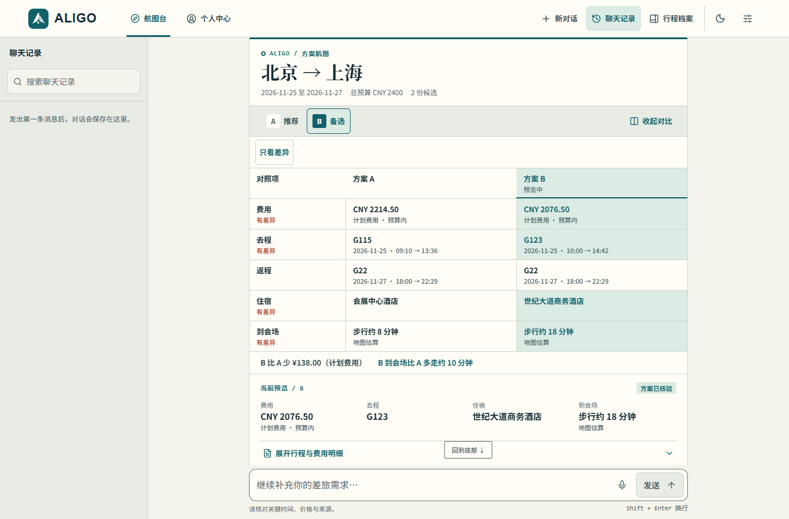
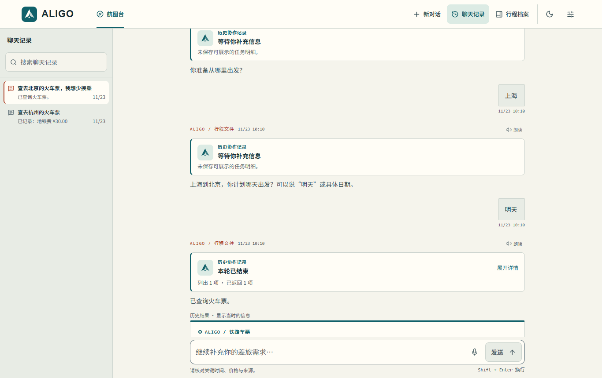
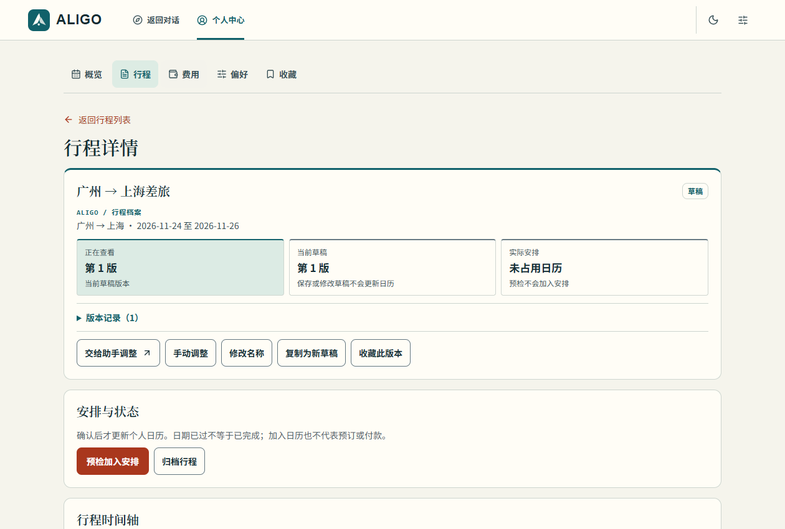

# ALIGO 智能差旅助手

ALIGO 将差旅需求拆成可追踪的任务：查交通、住宿和天气，比较候选行程，再把选中的方案保存到个人中心。聊天按会话分开，同一浏览器身份下的会话共用行程、账本和偏好。

## 界面演示

> 下图来自本地隔离环境。车次、报价、酒店、行程和费用均为测试示例，不代表实时供应或真实交易。

### 差旅方案对比

并排比较去返程、住宿、到会场的距离与预算，支持只看差异。



### 聊天记录与续聊

点击「＋」新建会话；旧会话可以按关键词搜索、打开并继续对话。



### 个人中心

回看行程草稿和历史版本，查看时间轴，确认后再加入安排。也可在这里管理费用、偏好和收藏。



## 快速开始

需要 Python 3.12 和 Node.js 22.13+（推荐 Node.js 24）。以下命令在项目根目录执行：

```bash
python -m venv .venv
# Windows PowerShell：.\.venv\Scripts\Activate.ps1
# Linux/macOS：source .venv/bin/activate
python -m pip install -r requirements.txt
```

将 `.env.example` 复制为 `.env`，填写你自己的 `ALIGO_API_KEY`、`ALIGO_BASE_URL` 和 `ALIGO_MODEL_NAME`。天气、地图和语音使用各自的可选配置。不要提交真实 `.env`。

```bash
npm --prefix web ci
npm --prefix web run build
python scripts/build_rag_index.py
python -m uvicorn server.app:app --host 127.0.0.1 --port 8000
```

访问 [本机差旅助手](http://127.0.0.1:8000/)。开发前端时可运行 `npm --prefix web run dev`，默认将接口转发到本机 8000 端口。

## 项目结构

| 目录 | 用途 |
| --- | --- |
| `agents/`、`.claude/skills/` | 意图识别、任务编排和专业技能 |
| `server/` | 流式聊天、历史记录、个人中心和 Web 接口 |
| `context/`、`db/`、`cache/` | 本地持久化、可选 PostgreSQL 和 Redis |
| `rag_core/`、`scripts/` | 知识库检索和离线索引构建 |
| `web/` | React 前端和前端测试 |
| `tests/`、`tools/` | 回归测试、维护工具和静态检查 |

## 测试

```bash
python -m pip install -r requirements-dev.txt
python -m pytest -m 'not integration' -q
npm --prefix web test
```

浏览器验收需要额外安装 Playwright 和 Chromium，步骤见[聊天记录文档](docs/CONVERSATION_HISTORY.md)。

## 数据与边界

- 默认使用本地 JSON，首次运行生成数据。仓库不包含真实用户、凭据或部署配置。浏览器身份不等于跨设备账号，切换浏览器不会自动同步历史。
- 仓库自带的知识库是虚构样文，不是企业制度或真实签证政策；替换成你有权使用的文本后，可重新构建索引。
- 看历史不会重新查价或执行预订。实际价格及余量以供应商为准，费用写入前需要明确确认。
- 更多说明：[聊天记录](docs/CONVERSATION_HISTORY.md) · [个人中心与存储](docs/PERSONAL_CENTER_RUNBOOK.md)。

