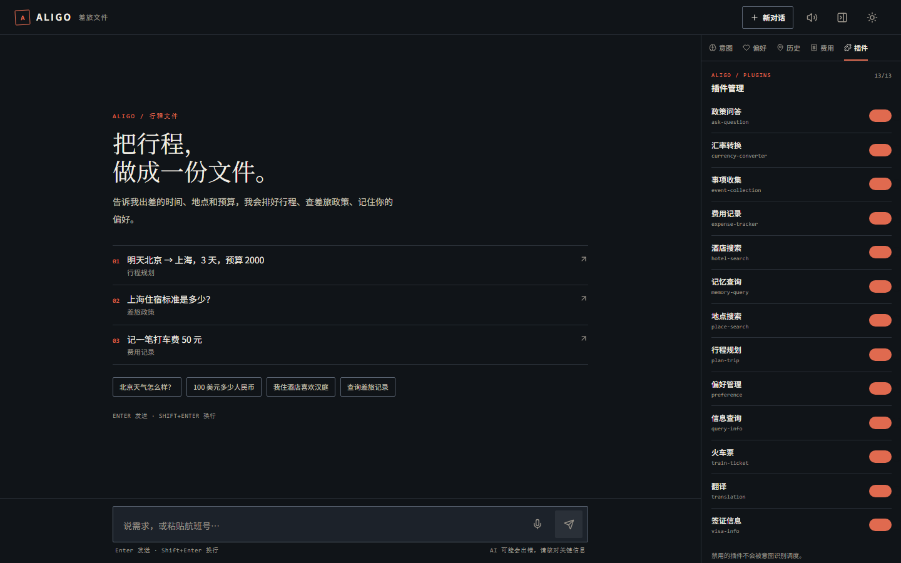

# 前后端适配记录

日期：2026-10-20  
范围：`aligo/web`（React）与 `aligo/server`（FastAPI + SSE）

## 1. 开发端口与代理

本机 **8000 / 8010 已被其他 Python 服务占用**，Aligo 当前使用 **8011**。

- 后端：`uvicorn server.app:app --reload --port 8011`
- 前端：`npm run dev`（5174）
- 代理：`web/vite.config.ts` 读取 `VITE_API_TARGET`，默认 8000
- 本机配置：`web/.env.development` → `http://localhost:8011`

这样换机器/换端口只改环境变量，不再把端口写死在 Vite 配置里。

## 2. 会话生命周期

之前的问题：偏好 / 历史 / 费用 / 插件 PUT 都要求“用户先发过一条消息”才有 session，
首次打开侧栏会 404。

现在：

1. App 首屏调用 `POST /api/session/new`，把 `session_id` 写入 zustand / localStorage。
2. 侧栏读取接口带上 `session_id`。
3. 后端 `_get_user_session()` 带 `session_id` 时直接按它 `get_or_create`；
   没带才复用活跃 session 或新建，不要求用户先聊天。
4. 刷新页面 / 后端重启后，用 localStorage 里的 id 重建，聊天与侧栏仍是同一个会话。

## 3. SSE 契约

后端事件：

```text
thinking / intention / dispatching / agent_start / agent_result / complete / error / clarification
```

前端对应的修正：

- `agent_start` / `agent_result` 增加 `priority`（后端队列里原本只有 agent_name/status/data）。
- SSE 解析在每个 `data:` 后清空 `currentEvent`，避免 keepalive 或无 event 的 data 被当成上一条 `agent_result`。
- 未知事件（ping / keepalive）显式忽略。
- 流结束但没有 `complete` / `error` / `clarification` 时，按不完整结果报错并显示「重试」。

## 4. 数据形状修正

- **偏好卡**：后端 PreferenceAgent 返回顶层 `preferences: [...]`；
  前端之前找 `preferences.preferences`，会空卡。现在同时兼容顶层数组和嵌套结构。
- **行程卡**：plan-trip 的 `daily_plans[].day` 是数字，不是字符串；
  现在渲染「第 N 天」，并显示 `date / city / theme`。
- **历史 / 费用排序**：JSON 存储正序、PG 倒序，API 层统一成「最新在前」，前端不再反转。
- **朗读事件**：narrate 的 `currentEvent` 原来声明在 while 循环内，SSE 跨 chunk 时会丢事件；已提升到循环外。
- **JSON answer**：memory-query 的 `answer` 偶尔是整段 JSON，后端先取出自然语言，前端朗读/知识卡再做一次兜底解包。
- **插件**：补齐 hotel-search / place-search / train-ticket / translation / visa-info 的中文名。
- **费用**：`expense_tracking` 与 `expense_tracker` 两种 agent 名都路由到费用卡。
- **来源链接**：天气/搜索来源 URL 异常时不再让 `new URL()` 抛错。

## 5. 实测

生产入口 `http://127.0.0.1:3003`（FastAPI + `web/dist` 同源）：

- `POST /api/session/new` → 200
- `GET /api/history` → 200，返回 1 条行程
- `GET /api/preferences` / `expenses` / `plugins` / `tts/personas` → 200
- 侧栏 5 个 tab 全部加载，0 个 console error
- 真实 SSE：`记一笔打车费 50 元` → 7 个事件，
  `agent_result` 带 `priority: 1`，`complete` 含 `expense_tracking` 结果
- 真实 SSE：`我喜欢住汉庭` → `preference` 顶层数组结果，前端卡可解析
- **重场景真实 UI E2E**：行程规划（43s）渲染「第 1 天」逐日卡片；酒店搜索渲染
  `ALIGO / STAY` 与 15 家结果，测试用户数据已清理
- **TTS 音频回放**：播放按钮触发 12 个 `AudioBufferSourceNode`，状态
  `loading → playing → idle`，`/api/tts` 200，无 console error
- **narrate → TTS**：自动朗读链路成功调用 `/api/narrate` 与 `/api/tts`，音频节点启动



## 6. 自动化测试

### 后端契约

```bash
python -m pytest tests/test_web_contracts.py -q
```

覆盖：health、静态 index + no-cache、session、history/preferences/expenses、插件、
personas、历史排序。当前结果：**4 passed**（无音频环境时 2 项 skip）。

### TTS / narrate 契约（本地 mock 上游）

本机没有 `MIMO_API_KEY` / `NARRATION_API_KEY`，所以用
`tests/mock_audio_provider.py` 提供同协议的 SSE 与 PCM16 音频：

```bash
# 终端 1：mock 上游
python -m uvicorn mock_audio_provider:app --app-dir tests --port 3015

# 终端 2：带 mock 配置的 Aligo
$env:MIMO_API_KEY='test'; $env:MIMO_BASE_URL='http://127.0.0.1:3015/v1'
$env:NARRATION_API_KEY='test'; $env:NARRATION_BASE_URL='http://127.0.0.1:3015/v1'
$env:ALIGO_PORT='3014'; python server/app.py

# 测试
$env:ALIGO_AUDIO_BASE_URL='http://127.0.0.1:3014'
python -m pytest tests/test_web_contracts.py -q
```

当前结果：**6 passed**（TTS 12 个 PCM chunk / 1.2s；narrate delta 文本）。

### 浏览器 UI E2E

`web/e2e/run-e2e.mjs` 自动启动 Edge、设置测试用户、发送真实消息并断言卡片：

```bash
cd web
$env:BASE_URL='http://127.0.0.1:3003'; $env:MODE='heavy'; node e2e/run-e2e.mjs
$env:BASE_URL='http://127.0.0.1:3014'; $env:MODE='audio'; node e2e/run-e2e.mjs
```

当前结果：
- heavy：**PASS**（itinerary + hotel，4 个 API 调用，0 error）
- audio：**PASS**（TTS 预览 + narrate→TTS，7 个 API 调用，0 error）

## 7. 未覆盖

- **真实 MiMo / 播报厂商**：本机没有两个 API Key，音频链路用同协议 mock 验证；
  填上 `MIMO_API_KEY` / `NARRATION_API_KEY` 后即可切到真实音色。
- 火车票等其余重场景，以及 Lighthouse / axe 视觉回归未做。
