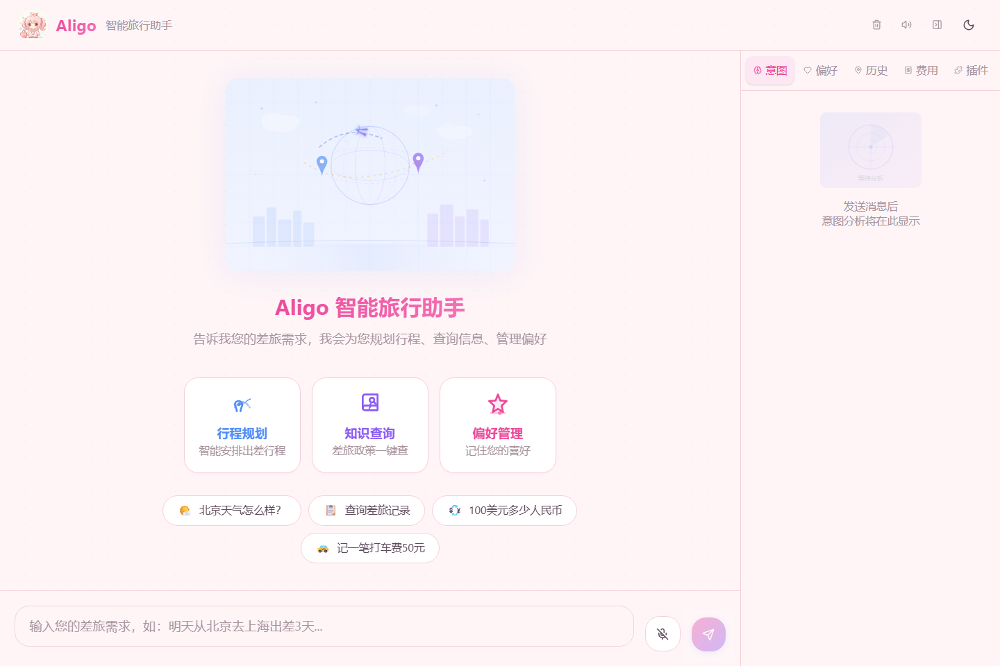
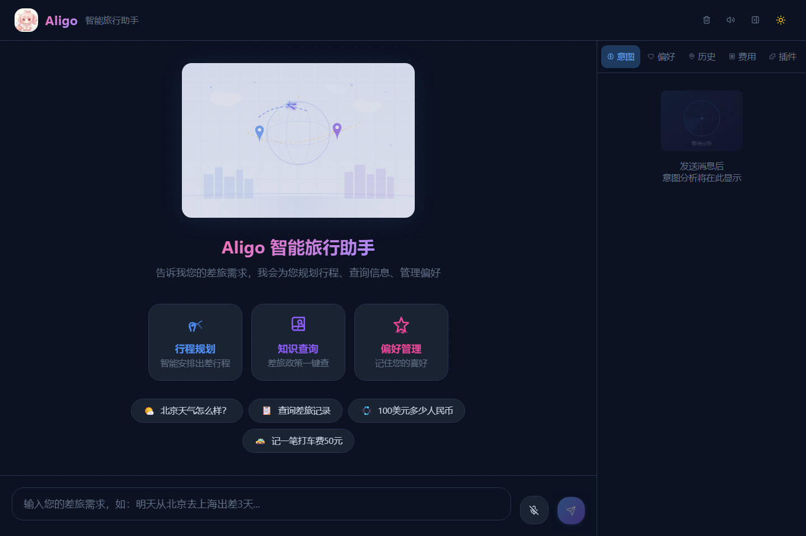
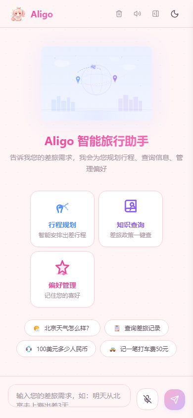
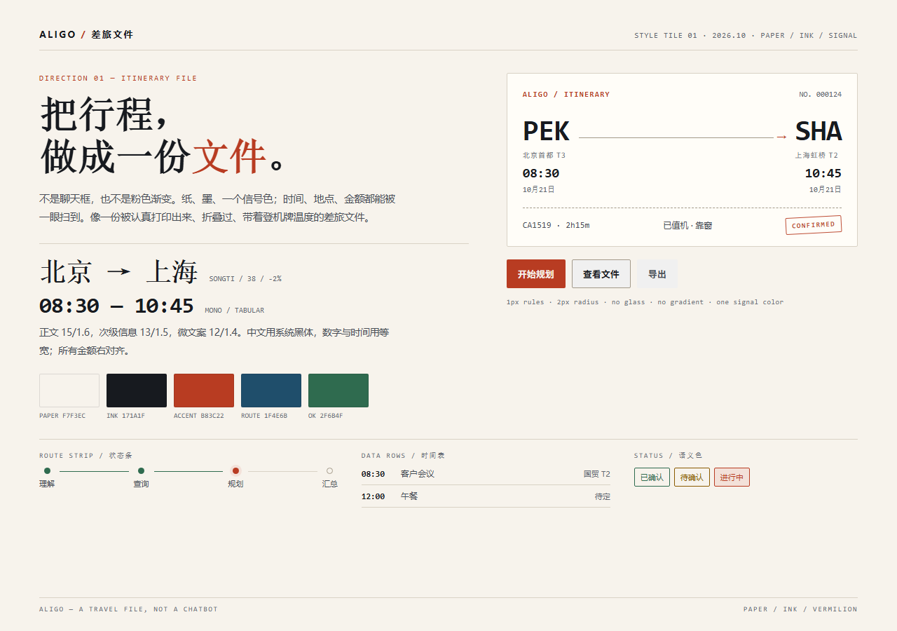
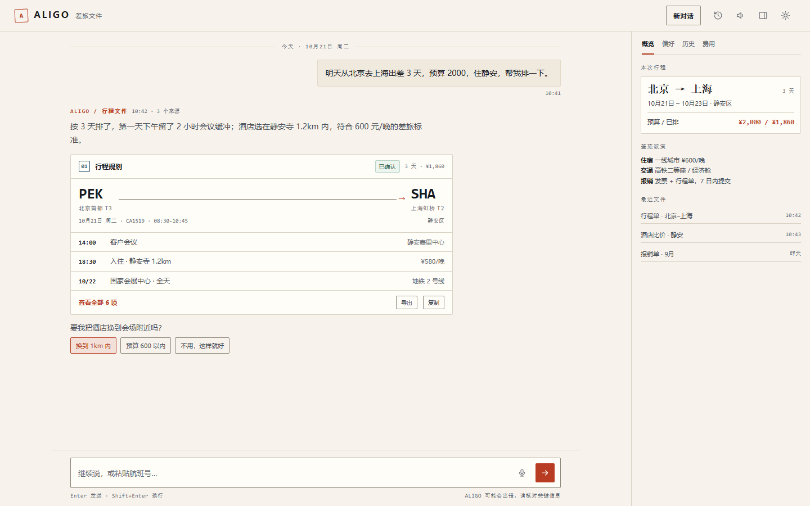
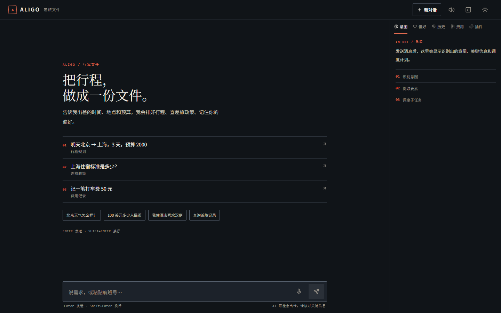
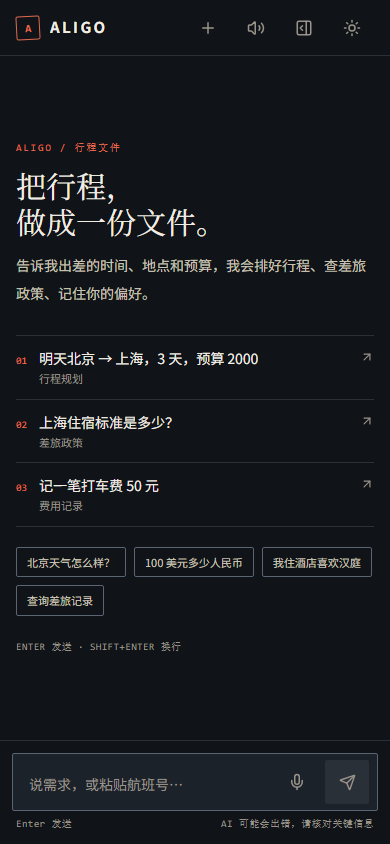
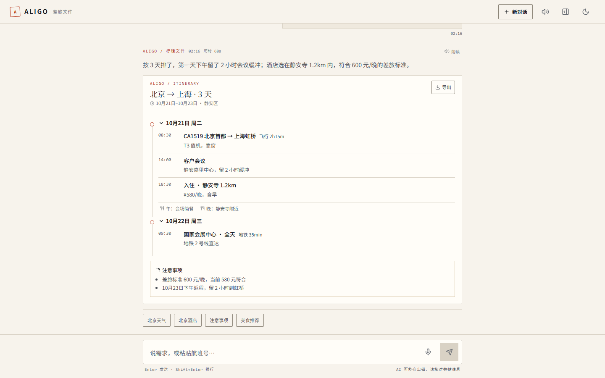
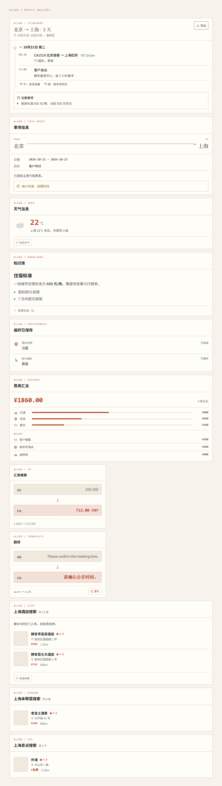
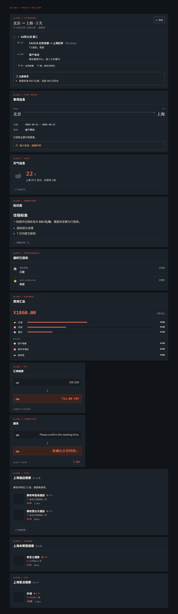

# Aligo 前端 UI 优化方案 v2

## 从「AI 聊天演示」到「差旅工作台」

> 版本：v2.0 · 2026-10-20  
> 范围：web/（React 19 + Vite 8 + Tailwind 4）  
> 依据：代码审计、生产构建、亮/暗/移动端截图、WCAG 对比度计算、既有 UI 文档  
> 不涉及：后端编排、Agent 逻辑、数据协议（只加一层展示适配）

---

## 0. 先给结论

1. 当前 UI 的问题不是「不够漂亮」，而是**没有主张、没有系统**：55 个硬编码色、13 处渐变、3 套图标、3 种卡片头、2 套主题色相、0 个 aria 属性。
2. 上一轮优化（UI_OPTIMIZATION.md、ui_optimization_plan.md、暖色凭条）解决的是「不够丰富」；这一轮要解决的是**「太丰富，互相打架」**。
3. 推荐方向：**聊天优先的行程文件**——聊天框和输入条保留；纸、墨、一个信号色；助手回复 = 一段人话 + 可扫描、可导出的文件块。
4. 三周左右（1 名前端 + 设计评审）可完成 P0–P3 的主体改造；先做「系统重置 + 减法」，再做「视觉记忆点」。
5. 不做什么：不换后端、不重写业务逻辑、不引入组件库、不做大面积 3D/插画、不把主界面改成 dashboard/文件管理器——聊天框保留。

**一句话判断**：Aligo 现在像一个「会卖萌的 AI 聊天框」，但它的业务是「企业差旅」。先把身份统一，再谈美化。

### 0.1 如果只做三件事（第一周）

1. **删掉 130% 根字号 + 压缩三张图**（半天）：桌面立刻回到 16px 基准；首屏图片从 1.33 MB 降到 <150 KB。
2. **把粉紫渐变/玻璃/发光/emoji 图标换成纸墨 token + 一套 Lucide**（2 天）：先去掉最明显的「AI 味」，不急着改布局。
3. **修 6 个可用性 bug**（2 天）：IME Enter 误发、清空无确认、正文被卡片吞、图标按钮无 aria-label、弹窗无焦点陷阱、对比度不达标。

---

## 1. 现状：五个根因

### 1.1 基线数据（2026-10-20 实测）

| 维度 | 实测 | 问题 |
|---|---|---|
| 生产构建 | JS 444.21 KB / gzip 132.68 KB；CSS 32.40 KB / gzip 7.07 KB | 体量可接受，但有拆分空间 |
| 首屏图片 | logo.png 600×600 / 565 KB、user.png 586×585 / 453 KB、反问框图片.jpeg 822×840 / 307 KB；展示尺寸 32 / 53 / 72 px | 约 1.33 MB 换不到 1 MB 的清晰度 |
| 根字号 | 桌面 20.8px（globals.css:7 的 html{font-size:130%}），移动 16px；768px 处跳变 | 所有 rem 尺寸放大 30%，px 值不放大 |
| 布局实测 | 桌面侧栏 374.4px、Header 72.8px、输入框 59.2px | 全部比设计意图大 30% |
| 对比度 | muted 2.68、accent 3.30、白字/粉 3.53、暗色白字/蓝 2.54、success 2.37、warning 2.01 | 大面积低于 AA 4.5 |
| ARIA | aria-* / role= 命中 **0** | 图标按钮、弹窗、开关、抽屉全裸 |
| 视觉常量 | 55 个 hex、13 处 linear-gradient、19 处 10–13px 文字 | 没有 token 约束 |
| 启动请求 | personas + plugins + preferences + history + expenses 共 5 个 | 用户没打开侧栏也请求 |
| 死代码 | index.css、App.css、StreamingPanel、ThinkingIndicator、Vite 模板资源 | 维护噪音 |
| Markdown | 未安装 @tailwindcss/typography，但两处使用 prose | 标题/列表/引用无样式 |
| 图标 | 自定义 SVG + Lucide + emoji 三套 | 同一屏三种视觉语言 |

**当前桌面端（亮色）**

**当前桌面端（暗色）**

**当前移动端（390px）**

### 1.2 根因一：没有设计系统，只有局部美化

- globals.css 定义了一套粉色调，AgentIcon.tsx 又定义了 12 个 agent 色，PreferencePanel 另有一套浅色/深色分类色，CompactReceipt 再有暖棕纸色。
- 卡片头有三种：渐变头（ItineraryCard）、左侧色条（CardShell）、裸容器（CompactReceipt）。
- 图标有三种：自定义 SVG（public/images/icons）、Lucide、emoji（⬆️🚗🍽️）。
- 结果：每个组件单看都「有设计」，合起来像不同人做的拼贴。

### 1.3 根因二：全局 130% 缩放

web/src/styles/globals.css:7：

~~~css
@media (min-width: 768px) {
  html { font-size: 130%; }
}
~~~

- 桌面根字号 20.8px，h-14 变成 72.8px，w-72 变成 374.4px，p-4 变成 20.8px。
- 但 text-[10px]、h-[53px]、max-h-[480px] 是 px，不跟着放大。
- 768px 处字号从 16px 直接跳到 20.8px，是一个可见的布局跳变。
- 结论：删除这行；用明确的 type scale 控制字号，不要用全局缩放代替排版。

### 1.4 根因三：品牌信号分裂

| 信号 | 现状 | 暗示 |
|---|---|---|
| 视觉 | 粉色渐变、玻璃态、动漫头像、emoji、loli 默认音色 | 消费级、可爱、陪伴 |
| 文案 | 「差旅需求」「企业差旅知识库」「报销政策」 | B 端、专业、效率 |
| 结果 | 行程单、报销凭条、酒店比价 | 工具、可信、可打印 |

这不是「风格不统一」这么简单，而是**产品身份没有决定**。必须选一个：

- **A. 专业差旅工作台（推荐）**：保留一点温度，但整体可信、克制、可打印。
- **B. 消费旅行伙伴**：那就把可爱做到极致，粉、圆、动画、角色都统一，不要一半专业一半卖萌。
- **C. 双品牌**：Aligo Pro（企业）/ Aligo Fun（个人），共用组件但两套 theme。

本方案按 **A** 展开；如果选 B，第 3 节的色彩/字体/圆角需要整体替换。

### 1.5 根因四：可访问性缺位

- 全仓 0 个 aria-* / role=。
- Header 四个图标按钮只有 title（Header.tsx:21/28/30 等），键盘/读屏用户只能听到「按钮」。
- 抽屉没有 aria-modal、焦点陷阱、Escape、滚动锁定。
- TTS 弹窗没有 role="dialog"；开关是普通 button，没有 role="switch" / aria-checked。
- ProactiveQuestion 是带 onClick 的 div（ProactiveQuestion.tsx:31），键盘不可达。
- 图标按钮 p-2 + 15px 图标 ≈ 31px，低于 44px 目标。
- 中文输入法按 Enter 选词会直接发送：InputBar 的 handleKey 没有判断 isComposing。

### 1.6 根因五：状态与信息架构不完整

- **正文被卡片吞掉**：MessageBubble 只在 !hasResults 时渲染 msg.content（MessageBubble.tsx:195 附近），有卡片时模型写的总结/解释完全不可见。
- **静默失败**：多个面板 catch { /* ignore */ }，用户只看到空白，不知道是没数据还是请求失败。
- **无超时/重试/离线态**：fetchJson 没有 timeout；流断了只显示「连接失败」，没有重试按钮。
- **嵌套滚动**：酒店/餐厅/景点列表 max-h-[480px] overflow-y-auto（HotelCard.tsx:107 等），思考时间线 max-h-48（NarrativeTimeline.tsx:41），在聊天滚动里再套滚动。
- **滚动劫持**：每次消息/处理状态变化都 scrollIntoView，用户往上翻会被拽回底部。
- **破坏性操作无确认**：点 logo 或垃圾桶直接 clearChat（Header.tsx:21/28），没有确认/撤销。
- **启动即请求**：侧栏 5 个面板全部挂载并各自 useEffect 拉数据（Sidebar.tsx:47 起），TTS 角色也在 App 启动时拉（TTSSettings 里 useLoadPersonas 在 open 判断之前）。
- **每条 AI 消息都请求 LLM 追问**：FollowUpSuggestions 对每条有结果的历史消息都延迟 1.5s 请求（FollowUpSuggestions.tsx:64），长对话会放大成 N 个请求。

---

## 2. 方向：行程文件（Itinerary File）

### 2.1 三个方向

| 方向 | 关键词 | 优势 | 风险 | 适配 |
|---|---|---|---|---|
| **A. 行程文件** | 纸、墨、朱砂、登机牌、行程单、等宽数字 | 与业务同构；可打印；克制；易做 a11y | 容易过冷；需要字体/留白撑住温度 | **推荐** |
| B. 航线图 | 地图、坐标、航线、节点、深蓝 | 规划感强；已有 FlightMap | 聊天中放地图噪音大；移动端不可读 | 作为辅助母题 |
| C. 温暖编辑部 | 石灰、黄铜、衬线、摄影、酒店纸品 | 高级、旅行感 | 实现成本高；对图片依赖大；不够工具化 | 二期可选 |

### 2.2 为什么推荐 A

- 产品输出本来就是「文件」：行程、报价、报销、政策，而不是闲聊。
- 现有资产已经埋了种子：CompactReceipt 的纸质凭条、ItineraryCard 的时间线、FlightMap 的路线。A 是**延长它们**，不是推翻重来。
- 与「AI 聊天 demo」拉开距离：不靠渐变、玻璃、发光，靠版式、规则线、数字。
- 三周可落地：不需要 3D、不需要插画库、不需要新组件库。
- 对可访问性天然友好：高对比纸墨、少动效、清晰焦点。

### 2.3 视觉语法样张（不是布局）

> 这张只展示**视觉语法**：纸/墨/朱砂、1px 规则线、2px 圆角、宋体标题、等宽数字、印章式状态。它不是最终布局。

#### 2.3.1 聊天态样张（保留聊天框）

> 主界面仍然是聊天：消息线程 + 输入框。助手回复 = 一段人话 + 一个可折叠、可导出的文件块；侧栏是辅助，可收起。

### 2.4 八条原则

1. **聊天框保留，输出文件化**：聊天是主入口；助手回复 = 一段人话 + 可扫描、可导出、可打印的文件块，不把气泡当作唯一容器。
2. **信息先于装饰**：先保证时间、地点、金额、状态可读，再谈氛围。
3. **一个强调色，一套语义色**：朱砂只给主操作/进行中/关键数字；成功/警告/错误只用语义色。
4. **时间和金额必须可扫描**：等宽、tabular、右对齐；不要用渐变字。
5. **一屏一个主操作**：空状态、错误态、弹窗都只有一个明确的主按钮。
6. **动效解释状态，不表演**：只做 120–200ms 的进入/状态变化；不做无限发光/漂浮。
7. **删除必须保留 signifier**：删文字要补标签/提示；删按钮要保留入口。
8. **移动端是主场景**：差旅用户在路上；先设计 390px，再扩展到桌面。

### 2.5 参考坐标系（不是抄）

- 纸质登机牌、JR 时刻表、日本旅行手册：学**信息层级和规则线**，不学配色。
- Linear：学密度、键盘、字体克制。
- Stripe Docs：学表格、代码、说明文的清晰。
- Airbnb：学旅行图片的信任感，不学它的圆角和阴影。
- **不要**把 Dribbble 上的「AI 风」当目标；目标是「能被打印出来、贴在护照夹里」。

### 2.6 品牌人格

- 从「动漫助手」到「可靠的差旅搭档」：语气平静、具体、有温度，不卖萌。
- Logo：建议 wordmark + 印章式标记；动漫角色可以保留为 24px 的「concierge」头像，但不要做 224px 的主视觉。
- TTS 默认音色：从 loli_guide 改成中性、清晰的成人声；角色列表保留，作为可选。
- 这是一个产品决策，不是视觉细节。**不要停在中间**：要么专业，要么彻底可爱。

---

## 3. 设计系统

### 3.1 色彩

**亮色（纸）**

| Token | 值 | 用途 | 对比度（on paper） |
|---|---|---|---|
| --paper | #F7F3EC | 页面底色 | — |
| --paper-raised | #FFFDF8 | 卡片/文件块 | — |
| --paper-sunken | #EFE9DE | 次级区块/表头 | — |
| --ink | #171A1F | 主文字 | 15.77 |
| --ink-2 | #4A4F57 | 次级文字 | 7.45 |
| --ink-3 | #666B73 | 辅助文字/时间 | 4.85 |
| --rule | #D9D2C5 | 装饰分隔线 | 1.36（非文字） |
| --rule-strong | #8C8578 | 输入框/可交互边框 | 3.31 |
| --accent | #B83C22 | 主操作/进行中/强调 | 5.12 |
| --accent-hover | #9E301A | hover/active | 6.57 |
| --accent-tint | #F3E1D9 | 强调底色 | — |
| --route | #1F4E6B | 路线/链接/信息 | 8.04 |
| --route-tint | #DDE8EE | 信息底色 | — |
| --ok | #2F6B4F | 成功 | 5.69 |
| --warn | #8A5A00 | 警告 | 5.36 |
| --err | #A3302A | 错误 | 6.30 |

白字在朱砂上：5.66，可用于主按钮。

**暗色（夜航）**

| Token | 值 | 对比度（on paper） |
|---|---|---|
| --paper | #101418 | — |
| --paper-raised | #1C222A | — |
| --paper-sunken | #171C22 | — |
| --ink | #F2EDE4 | 15.86 |
| --ink-2 | #C9C3B8 | 10.55 |
| --ink-3 | #9A948A | 6.15 |
| --rule | #2A3038 | 1.4（非文字） |
| --rule-strong | #5A6472 | 3.08 |
| --accent | #E06A4F | 5.59 |
| --accent-hover | #F07C62 | — |
| --route | #7FB3D5 | 8.20 |
| --ok | #6FBF9A | 8.45 |
| --warn | #E0B45C | 9.56 |
| --err | #E58A80 | 7.29 |

暗色不是亮色的色相翻转：强调色仍是朱砂系，只是提亮；不要切到蓝色，否则品牌记忆断掉。

**规则**

- 禁止品牌渐变；允许的唯一「渐变」是纸张噪点/极淡纹理（可选）。
- 强调色只用于：主按钮、当前 tab、进行中状态、关键数字。
- 语义色只用于状态，不做装饰。
- 图表/进度条用 route + accent，不用彩虹。

### 3.2 字体与排版

| 角色 | 字体 | 字号/行高 | 字重 | 用途 |
|---|---|---|---|---|
| Display | 宋体（Songti SC / Noto Serif SC） | 32/1.15（移动 26） | 600 | 页面标题、城市名 |
| H2 | 宋体 | 24/1.2（移动 20） | 600 | 区块标题 |
| H3 | 系统黑体 | 18/1.3 | 600 | 卡片标题 |
| Body | 系统黑体 | 15/1.6 | 400 | 正文 |
| Small | 系统黑体 | 13/1.5 | 400 | 辅助信息 |
| Micro | 系统黑体 | 12/1.4 | 500 | 标签/时间 |
| Mono | IBM Plex Mono / Consolas | 13/1.5 | 500 | 时间、金额、航班号 |

- 中文：PingFang SC, MiSans, Noto Sans SC, Microsoft YaHei。
- 西文/数字：只子集化 Latin + 数字，woff2，font-display: swap；不加载中文 webfont。
- 数字统一 font-variant-numeric: tabular-nums；金额右对齐。
- 正文最大行宽 68ch；不要全屏铺满。
- 不要用渐变字；不要用 10px 以下的正文。

### 3.3 间距、圆角、边框、阴影

- 间距基数 4px：4 / 8 / 12 / 16 / 24 / 32 / 48 / 64。
- 圆角：卡片 2px、输入 4px、按钮 2px、状态点 999px；不要全站 16/20px。
- 边框：1px --rule；可交互元素用 --rule-strong。
- 阴影：只给弹窗/浮层：0 12px 40px rgba(0,0,0,.18)；卡片用边框，不用阴影。
- 玻璃态：删除（backdrop-filter 在移动端有 GPU 成本，且与纸墨方向冲突）。
- 网格：12 列桌面 / 4 列移动；内容最大 1200px；聊天列 720px；侧栏 320px。

### 3.4 动效

- 时长：120ms（hover）/ 180ms（进入）/ 240ms（抽屉/弹窗）。
- 曲线：cubic-bezier(.2,.8,.2,1)。
- 只动 transform / opacity；不要动 width/height/top/left。
- 禁止：无限 glow、无限 float、每条消息的 scale-in、数字逐字滚入。
- prefers-reduced-motion: reduce：关闭所有非必要动画，包括 skeleton shimmer、typewriter、SVG animate。
- 状态变化用颜色/边框/短位移解释；不要用「表演」掩盖加载。

### 3.5 图标与插图

- 一套图标：Lucide，16/20/24，stroke 1.75。
- Agent 图标：单色线框，20px；不要 12 色。
- 禁止 emoji 当 UI 图标；emoji 只出现在用户内容里。
- 空状态：用排版 + 路线图 + 印章，不用动漫主视觉。
- 如果保留角色：24px 头像，只在「谁在说话」时出现；不做 224px hero。
- SVG 插图必须支持暗色：用 currentColor 或提供 dark 变体；当前 welcome-hero.svg 有烘焙的浅色底，暗色下是一块发光白板。

### 3.6 Tailwind v4 落地

~~~css
@import "tailwindcss";
@custom-variant dark (&:where(.dark, .dark *));

@theme {
  --color-paper: #f7f3ec;
  --color-paper-raised: #fffdf8;
  --color-paper-sunken: #efe9de;
  --color-ink: #171a1f;
  --color-ink-2: #4a4f57;
  --color-ink-3: #666b73;
  --color-rule: #d9d2c5;
  --color-rule-strong: #8c8578;
  --color-accent: #b83c22;
  --color-accent-hover: #9e301a;
  --color-accent-tint: #f3e1d9;
  --color-route: #1f4e6b;
  --color-route-tint: #dde8ee;
  --color-ok: #2f6b4f;
  --color-warn: #8a5a00;
  --color-err: #a3302a;

  --font-sans: "PingFang SC", "MiSans", "Noto Sans SC", "Microsoft YaHei", sans-serif;
  --font-display: "Songti SC", "Noto Serif SC", "SimSun", serif;
  --font-mono: "IBM Plex Mono", Consolas, monospace;

  --radius-card: 2px;
  --radius-input: 4px;
}

@layer base {
  html { font-size: 16px; color-scheme: light; }
  .dark { color-scheme: dark; }
  :focus-visible { outline: 2px solid var(--color-accent); outline-offset: 2px; }
  @media (prefers-reduced-motion: reduce) {
    *, *::before, *::after { animation: none !important; transition: none !important; }
  }
}
~~~

> 迁移期可以保留旧变量名，映射到新 token，避免一次性改 50 个文件；但新代码只能用新 token。

---

## 4. 组件重构

### 4.1 基础组件

| 组件 | 变体 | 尺寸 | 状态 | 可访问性 |
|---|---|---|---|---|
| Button | primary / secondary / ghost / danger | 32 / 40 / 44 | hover / active / disabled / loading | 原生 button；loading 时 aria-busy |
| IconButton | ghost / solid | 44×44 命中区 | hover / active / pressed | 必须 aria-label + tooltip |
| Input / Textarea | 单行 / 多行 | 44 高；自动增高至 4 行 | focus / error / disabled | label 关联；IME isComposing |
| Tabs | underline / segmented | 40 | active / hover | roving tabindex；方向键 |
| Badge / Status | dot + label | 24 | ok / warn / err / neutral | 不只靠颜色，必须有文字 |
| Dialog / Sheet | center / bottom | — | open / closing | role=dialog、aria-modal、焦点陷阱、Escape、恢复焦点 |
| Menu | dropdown | 40/项 | open / focus | role=menu、方向键、Escape |
| Toast | info / success / error | — | auto-dismiss 5s | aria-live=polite；可撤销 |
| EmptyState | 单动作 / 双动作 | — | — | 标题 + 说明 + 一个主按钮 |
| Skeleton | text / card | — | — | reduced motion 下静态 |
| DocumentBlock | 文件块 | — | loading / empty / error / partial | 标题层级、状态文本 |
| RouteStrip | 3–5 节点 | — | pending / active / done / error | aria-live；文字状态 |
| DataRow | 键值/时间表 | 40 | — | 语义 dl 或 table |
| Receipt | 凭条 | — | — | 等宽金额；非装饰 |

### 4.2 业务组件

- **Header**：wordmark + 「新对话」+ 图标按钮（44px）+ 主题。
- **ChatThread / Message**：用户 note / 助手 document section。
- **ThinkingStrip**：替代 FlightMap + NarrativeTimeline 的运行时大块。
- **ResultDocument**：所有 agent 结果的外壳；内部按类型渲染。
- **HotelList / ItineraryTimeline / ExpenseReceipt / PolicyAnswer / TranslationPair / CurrencyPair**。
- **FileSidebar**：tabs + sections + counts；懒加载。
- **TTSDialog**、**ExportMenu**、**ConfirmDialog**。

### 4.3 DocumentBlock 结构

~~~text
┌────────────────────────────────────────────┐
│ [icon] 行程规划        [已确认]  10:42     │  header: 20px icon + label + status + time
├────────────────────────────────────────────┤
│ 北京 → 上海 · 3 天 · 10月21日–23日         │  summary: 1 行
│                                            │
│ 08:30  客户会议        国贸 T2             │  rows: time / content / meta
│ 12:00  午餐            待定                │
│                                            │
│ [查看全部]                     [导出] [复制]│  footer: 12px muted + actions
└────────────────────────────────────────────┘
~~~

- 头部：20px 单色 icon、14px 标题、12px 状态、12px 时间。
- 主体：16px padding；表格/行；不用嵌套滚动；超过 5 行「查看全部」展开。
- 底部：来源、导出/复制/重试；12px，4.5:1。
- 状态：loading 用同结构 skeleton；error 用同结构 + 重试；partial 用同结构 + 提示。

### 4.4 替换映射

| 旧 | 新 | 处理 |
|---|---|---|
| CardShell + 渐变头 | DocumentBlock | 统一头部；删渐变 |
| CompactReceipt | Receipt | 保留纸张隐喻；去 !important；token 化 |
| ProactiveQuestion | ClarificationCard | 改 button；可键盘；去 72px JPEG |
| FlightMap + NarrativeTimeline | RouteStrip | 运行时用 4 节点；地图只留结果页 |
| AgentIcon 12 色 | AgentGlyph | 单色线框；颜色只表状态 |
| ThinkingIndicator / StreamingPanel | 删除或合并 | 当前未被引用 |
| text-gradient | 删除 | 金额/标题用纯色 |
| glass / card-hover | 删除/收敛 | 不用玻璃、悬浮位移 |

---

## 5. 页面与流程

### 5.0 交互模型：聊天优先，文件化输出

- 主界面永远是「消息线程 + 输入框」，不是 dashboard、不是文件管理器。
- 用户每条输入 = 一条消息；助手每条回复 = 一段人话 + 0..N 个 DocumentBlock。
- DocumentBlock 是消息内容的一种，不是独立页面；它可以折叠、导出、复制。
- 侧栏是辅助，可收起；不抢主列。
- 空状态仍是聊天输入 + 示例，不是 landing page。
- 文件详情可以是二级视图，但入口在消息里。

### 5.1 Header

- 高度 56px（px，不随 rem 缩放）。
- 左：wordmark（28px 标记 + 「ALIGO」），可选「差旅文件」小字。
- 中/右：「新对话」文本按钮；图标按钮：历史、语音、侧栏、主题；每个 44px 命中区 + aria-label。
- 「清空/新对话」：弹确认框；确认后 toast 5s 可撤销。
- 移动端：logo + 「新对话」+ 一个「更多」菜单；不要四个 15px 图标挤在 390px。

### 5.2 空状态

- 不要 224px 动漫 hero + 三张彩卡 + emoji chips。
- 用「空白行程单」：日期、路线线、3 条示例（北京 → 上海 · 3 天 · 预算 2000），一个主按钮「开始规划」。
- 示例点击即发送；文案要具体，不要「智能安排出差行程」这种空话。
- 背景保留极淡纸纹；不要 dot grid 0.5 透明度。

### 5.3 聊天线程

- 用户：右对齐 note，--paper-sunken，2px 圆角，最大 560px；不要粉紫渐变气泡。
- 助手：整宽 document section；小标签「ALIGO · 行程文件」+ 时间；正文可见；卡片在正文下。
- **有卡片时也要保留正文**：模型写的总结/解释是「人话」，卡片是「数据」；两者都要。可折叠「收起详情」。
- 头像：24px 印章/字母，不用 53px 的 565KB PNG。
- 时间：12px，4.5:1；「思考耗时」只在运行中显示，历史消息 hover 显示。
- 滚动：只有用户接近底部时才自动跟随；否则显示「新消息 ↓」按钮。
- 流式：aria-live=polite 只播报阶段变化，不播报每个 token。

### 5.4 思考/流式

- RouteStrip：理解 → 查询 → 规划 → 汇总；当前节点用 accent，完成用 ok，失败用 err；右侧显示已用时 + 「停止」。
- 不要 typewriter（25ms/字）；不要 SVG animate 无限脉冲；不要嵌套滚动。
- 超过 5s 显示具体阶段（「正在查询差旅政策…」），不要假进度。
- 地图只放在「行程结果」里，不在思考时占 110px 高。

### 5.5 结果

- 所有结果统一 DocumentBlock；标题用中文 agent label，不用 agent_name。
- **行程**：时间列（mono）+ 活动 + 备注；按天分组；导出/复制。
- **酒店**：56px 缩略图 + 名称 + 评分 + 距离 + 价格右对齐；5 行后「查看全部」，不要 480px 嵌套滚动。
- **费用**：凭条 + 虚线 + 等宽金额 + 分类条；不要渐变数字。
- **政策**：Q/A + 引用来源；来源 chip 可点击。
- **翻译/汇率**：两列对照 + 交换按钮；数字等宽。
- **错误**：同结构 + 一句人话 + 重试；不要只显示 HTTP 500。
- **汇总**：卡片上方一行「本次为你查了 3 项，生成 1 份行程」。

### 5.6 侧栏

- 320px；tabs 用下划线 + 计数，不用粉色 pill。
- 5 个面板按需加载：只有第一次激活才 fetch；不要 App 启动全量请求。
- 每个面板都有 loading / empty / error / retry；不要 catch {}。
- 移动端：全屏 sheet（右侧/底部），焦点陷阱、Escape、背景滚动锁。

### 5.7 弹窗与菜单

- TTS：role=dialog、aria-modal、焦点陷阱、Escape、关闭后恢复焦点；开关 role=switch aria-checked；试听按钮 44px。
- 导出：role=menu、方向键、Escape；打印窗口要转义 HTML（当前 document.write 直接拼文本，LLM 内容可能带标签）。
- 清空对话：确认框写清后果（「偏好和历史不会删除」）。

### 5.8 移动端

- 100dvh 替代 h-screen；env(safe-area-inset-bottom) 给输入区。
- 输入框自动增高到 4 行；placeholder 缩短，避免两行被裁切。
- 空状态示例 1 列；chips 横向滚动或 2×2；不要 hover-only。
- Header 只留 logo + 新对话 + 更多；侧栏用 sheet。
- 触控目标 ≥44px；不要 31px 图标按钮。

---

## 6. 状态与文案

### 6.1 状态矩阵

| 状态 | 触发 | UI | 文案 | 动作 |
|---|---|---|---|---|
| Initial | 无消息 | 空白行程单 | 「先说要去哪」 | 示例 / 输入 |
| Loading | 发送后 | 同结构 skeleton | 「正在理解…」 | 停止 |
| Streaming | SSE 中 | RouteStrip + 已用时 | 具体阶段 | 停止 |
| Partial | 流结束但缺 complete | 同结构 + 提示条 | 「结果可能不完整」 | 重试 |
| Success | complete | DocumentBlock | — | 导出/复制 |
| Empty | 结果为空 | 同结构 + 插画/排版 | 「没找到，换个关键词」 | 修改条件 |
| Error | 网络/服务/解析 | 同结构 + 错误块 | 人话 + 原因 | 重试 |
| Offline | navigator.onLine=false | 顶部 banner | 「离线了，恢复后再试」 | 重连 |
| Aborted | 用户停止 | 保留已得结果 | 「已停止」 | 继续 / 重试 |
| Clarification | 后端反问 | ClarificationCard | 问题 + 2–3 个选项 | 选择/输入 |
| Long | 内容超 5 行 | 折叠 | 「查看全部」 | 展开 |

### 6.2 文案规范

- 动词开头，具体：「删除这段对话？」而不是「确认操作」。
- 不用感叹号；不用「智能」形容一切；不用「哦/呀/呢」在系统文案里。
- 错误要给出下一步：「网络断了，检查一下再试」+「重试」。
- 日期：10月21日 周二；价格：¥1,280；时长：2小时15分。
- 空状态：一句说明 + 一个动作，不要三行欢迎语。

### 6.3 破坏性操作

- 清空对话、删除费用、禁用插件：确认 + 撤销（能撤销的）。
- 清空对话确认文案：「删除当前对话？偏好和历史记录不会删除。」按钮「取消 / 删除」。
- Toast 5s，可撤销；不要用 window.confirm（样式不可控、不可撤销）。

---

## 7. 可访问性

### 7.1 对比度

- 正文 ≥4.5:1；大字 ≥3:1；UI 组件/焦点 ≥3:1。
- 第 3.1 节 token 已按此校准；任何新增颜色必须过脚本（附录 B）。
- 不要用 opacity 降低文字对比度；用 --ink-3。

### 7.2 键盘与焦点

- 所有交互元素：原生 button / a / input；不要 div onClick。
- 焦点环：2px accent + 2px offset；不要 outline: none 除非有替代。
- Tab 顺序与视觉顺序一致；抽屉/弹窗打开时焦点进入并锁定；关闭后恢复。
- Tabs 方向键；Menu 方向键；Escape 关闭；Enter/Space 激活。
- 中文输入法：Enter 发送前判断 e.nativeEvent.isComposing。

### 7.3 ARIA

- 图标按钮：aria-label；tooltip 用 title 或自定义（不要只靠 title）。
- 展开/收起：aria-expanded；开关：role=switch + aria-checked。
- 弹窗：role=dialog + aria-modal=true + aria-labelledby。
- 流式：aria-live=polite + aria-busy；不要每个 token 播报。
- 状态：文字 + 颜色；不要只用红/绿点。
- 图片：内容图 alt；装饰图 alt=""；SVG 路线图加 title。

### 7.4 目标尺寸与动效

- 触控目标 ≥44×44；图标按钮的命中区用 padding 扩大。
- 支持 200% 缩放不丢内容；不要固定高度裁切。
- prefers-reduced-motion 下关闭所有非必要动画（包括 SVG SMIL）。
- 不要自动播放音频；TTS 默认关闭（当前默认已是 false，保持）。

### 7.5 验收清单（10 项）

- [ ] 所有文字对比度 ≥4.5（大字 ≥3）
- [ ] 键盘可完成：发消息、停止、切 tab、开弹窗、导出、清空
- [ ] 焦点始终可见；弹窗有陷阱和恢复
- [ ] 图标按钮都有 aria-label
- [ ] 开关/展开有状态属性
- [ ] 流式有 aria-live，但不刷屏
- [ ] 中文输入法 Enter 不误发
- [ ] 390px 无横向滚动、无裁切
- [ ] reduced motion 下无动画
- [ ] 200% 缩放可用

---

## 8. 性能

### 8.1 图片

| 文件 | 现状 | 展示 | 目标 |
|---|---|---|---|
| logo.png | 600×600 / 565 KB | 32 / 53px | 128×128 WebP/AVIF ≤12 KB |
| user.png | 586×585 / 453 KB | 53px | 128×128 WebP/AVIF ≤10 KB |
| 反问框图片.jpeg | 822×840 / 307 KB | 72px | 删除或 144×144 WebP ≤15 KB |
| welcome-hero.svg | 6.8 KB | 224–320px | 保留；加 dark 变体或去底色 |

- 用 srcset + sizes；width/height 固定比例，避免 CLS。
- 首屏图 fetchpriority=high；折叠下 loading=lazy。
- 目标：首屏图片 ≤150 KB（现在约 1.33 MB）。

### 8.2 字体

- 中文用系统字体；不加载 5MB 的 CJK webfont。
- 西文/数字子集：Archivo（标题）+ IBM Plex Mono（数字），合计 ≤60 KB woff2；preload 只给 mono。
- font-display: swap；避免 FOIT。

### 8.3 代码与渲染

- 拆包：react-markdown、suggestionEngine（29 KB 源码）、侧栏面板按需 import()。
- 删除死代码：StreamingPanel、ThinkingIndicator、index.css、App.css、Vite 模板资源。
- MessageBubble / ResultDocument 用 React.memo；store 用按消息 id 的 selector，避免每个 SSE 事件重渲染整列。
- 长对话（>100 条）再考虑虚拟列表；先做 memo。
- 移除生产 console.log（client.ts 每个 SSE 事件都打）。
- 目标：初始 JS ≤180 KB gzip；LCP ≤2.5s（4G）；CLS ≤0.1；INP ≤200ms。

### 8.4 网络

- 侧栏 5 个请求改为按需；TTS personas 延迟到打开弹窗。
- 追问建议只对「最后一条」AI 消息请求，不要每条历史都请求。
- fetchJson 加 timeout（如 60s）和错误类型；流式加 idle timeout。
- 失败重试：按钮手动重试，不做无限自动重试。

### 8.5 构建

- manualChunks 拆 vendor / markdown / suggestions。
- nginx 开 brotli/gzip；静态资源 hash 缓存一年，HTML 不缓存。
- 加 Lighthouse CI（或至少 Phase 0/5 手动跑）。

---

## 9. 响应式

### 9.1 断点

| 断点 | 布局 |
|---|---|
| <640 | 单列；Header 精简；侧栏 sheet；输入区底贴 |
| 640–767 | 单列；空状态 2 列示例 |
| 768–1023 | 聊天 + 可折叠侧栏；侧栏 overlay |
| 1024–1279 | 聊天 + 320px 侧栏 |
| ≥1280 | 最大 1200 内容；聊天列 720；侧栏 320 |

### 9.2 移动端细节

- 100dvh；不要 h-screen（移动浏览器工具栏会导致底部被裁）。
- padding-bottom: max(16px, env(safe-area-inset-bottom))。
- 输入框 auto-grow；placeholder 短。
- 空状态 1 列；chips 2×2 或横向滚动。
- 抽屉全屏 sheet；焦点陷阱；背景锁滚。
- 测试 320 / 375 / 390 / 414。

### 9.3 禁止

- 聊天区嵌套滚动（酒店列表、时间线）。
- hover-only 操作。
- 固定 px 高度包中文文本。
- 横向溢出。

---

## 10. 实施路线图

> 估算按 1 名熟悉 React/Tailwind 的前端 + 设计评审；不含后端改造。

| 阶段 | 时间 | 任务 | 产出 | 退出标准 |
|---|---|---|---|---|
| **P0 基线** | 1 天 | 截图、Lighthouse、对比度脚本、组件盘点、方向决策 | 基线报告 + 方向确认 | 决策人签字 |
| **P1 地基** | 2–3 天 | 删 130%、死代码；建 token；图片压缩；焦点/reduced-motion；字体子集 | tokens + 基础样式 | 新 token 可用；对比度脚本全过 |
| **P2 壳与聊天** | 4–5 天 | Header、空状态、Message、Input、Thinking、滚动、确认框、IME | 新壳 + 聊天 | 桌面/移动截图；键盘可发消息/停止 |
| **P3 结果与侧栏** | 4–5 天 | DocumentBlock、行程/酒店/费用/政策、侧栏 tabs、懒加载、TTS/Export 弹窗 | 全部结果卡 + 侧栏 | 12 类结果统一 anatomy；无嵌套滚动 |
| **P4 无障碍与状态** | 2–3 天 | ARIA、dialog、switch、aria-live、错误/空/离线/部分、文案 | a11y 通过 | axe 0 critical；键盘全流程 |
| **P5 性能与 QA** | 2 天 | 拆包、memo、图片、Lighthouse、视觉回归 | 指标 + 回归 | 指标达标；截图矩阵通过 |

**总计：15–19 个工作日**（约 3–4 周日历）。如果只有兼职投入，按 1.5× 估。

**依赖**：
- P1 的方向决策必须先定（A/B/C）。
- P3 需要后端结果结构稳定；先加 normalizeResult 适配层，不要在 12 个卡片里各自猜 data.data。
- P4 的文案需要产品确认（尤其清空/删除/错误）。

---

## 11. 验收标准

### 11.1 视觉

- 8 个屏幕 × 2 主题 × 3 视口（390 / 768 / 1440）截图通过。
- 所有卡片使用同一 DocumentBlock anatomy；无渐变头、无彩虹 agent 色、无 emoji 图标。
- 字体层级 ≤5 级；圆角 ≤2 种；阴影只出现在浮层。

### 11.2 可访问性

- axe：0 serious / critical；Lighthouse a11y ≥95。
- 键盘：发消息、停止、切 tab、开 TTS、导出、清空、关闭弹窗全部可完成。
- 对比度脚本：所有文本 ≥4.5；UI ≥3。
- 200% 缩放、reduced motion 通过。

### 11.3 性能

- 初始 JS ≤180 KB gzip；CSS ≤40 KB。
- 首屏图片 ≤150 KB；LCP ≤2.5s（4G）；CLS ≤0.1；INP ≤200ms。
- 移动 Lighthouse performance ≥85。

### 11.4 功能/回归

- 12 类 agent 结果都能渲染；错误/空/部分状态都有 UI。
- 清空可撤销；删除有确认；导出不 XSS。
- 断网/超时/流中断有明确提示和重试。
- 侧栏首次打开才请求；追问只请求最后一条。

### 11.5 代码规则

- 新代码 0 个硬编码 hex（token 除外）；0 个 !important；0 个 title-only 按钮。
- 所有交互元素有 focus 样式。
- 所有图片有 alt / 宽高。
- ESLint 规则：禁止 text-[10px]/text-[11px]、禁止品牌 linear-gradient、禁止 outline-none 无替代。

---

## 12. 风险与决策

| 风险 | 影响 | 缓解 |
|---|---|---|
| 品牌方向改变，老用户不认识 | 中 | 分阶段；保留角色作为可选 concierge；先改壳再改语气 |
| 后端结果结构不稳定 | 高 | 加 normalizeResult 适配层；卡片只消费统一结构 |
| 暗色素材缺失 | 中 | 先删烘焙底色的插图；用 currentColor/纯排版 |
| 范围蔓延 | 高 | P0 冻结功能；只做 UI/UX，不加新业务 |
| 无前端测试 | 中 | P5 加 Playwright 视觉回归 + 关键流程 |
| 字体授权/体积 | 低 | 中文系统字体；西文只用开源子集 |
| 设计评审主观 | 中 | 用截图 + 参考图 + pairwise；两轮上限；人拍板 |

### 需要你拍板的 5 件事

1. **方向**：A 行程文件（推荐）/ B 航线图 / C 温暖编辑部？
2. **角色**：保留动漫头像作为小 concierge，还是彻底换成 wordmark/印章？
3. **默认音色**：是否把 loli_guide 换成中性成人声？
4. **暗色优先级**：P2 一起做，还是 P4 再补？
5. **时间/人力**：3 周 1 人，还是压缩到 2 周 2 人？

---

## 13. 附录

### A. 评审 prompt（独立上下文）

~~~text
只根据截图评审，不要猜测代码实现。
产品/用户/任务：企业差旅助手；用户在手机上规划出差、查政策、记费用。
brief：纸/墨/朱砂的「行程文件」；信息优先；一个强调色；可打印。
参考（质量基线，不是模仿对象）：__（登机牌/JR 时刻表/Linear/Stripe Docs）
按顺序输出：
1) 一句话：它想成为什么
2) 三个最影响效果的问题：位置 / 现象 / 对用户或视觉的影响 / 可执行改法
3) 与参考相比最大的一个差距
4) 不打分；如果必须比较，把 4 张参考图和这张混在一起排序
~~~

- 给截图（390/768/1440 + 关键状态）、brief、参考；不给代码、实现历史、目标分。
- 最多两轮；每轮只改 top 1–3；人来拍板。

### B. 对比度脚本（Node）

~~~js
const lum = (hex) => {
  const c = [1, 3, 5].map(i => parseInt(hex.slice(i, i + 2), 16) / 255)
    .map(v => v <= .04045 ? v / 12.92 : ((v + .055) / 1.055) ** 2.4);
  return .2126 * c[0] + .7152 * c[1] + .0722 * c[2];
};
const ratio = (a, b) => {
  const [x, y] = [lum(a), lum(b)].sort((m, n) => n - m);
  return (x + .05) / (y + .05);
};
console.log(ratio('#666B73', '#F7F3EC')); // 4.85
~~~

### C. 审计命令

~~~bash
cd web
npm ci
npm run build          # 444.21 KB JS / 132.68 gzip
npx vite preview --port 4173
# Lighthouse（需本机 Chrome）
npx lighthouse http://localhost:4173 --view
~~~

### D. 文件地图

| 区域 | 文件 |
|---|---|
| 全局样式 | web/src/styles/globals.css |
| 壳 | web/src/App.tsx、web/src/components/Layout/Header.tsx |
| 聊天 | web/src/components/Chat/* |
| 结果 | web/src/components/Results/* |
| 侧栏 | web/src/components/Sidebar/* |
| 状态 | web/src/store/chatStore.ts |
| API | web/src/api/client.ts |
| 入口 | web/index.html、web/src/main.tsx |

### E. 证据截图

- ui-audit/current-desktop-light.png
- ui-audit/current-desktop-dark.png
- ui-audit/current-mobile-390.png
- ui-audit/direction-itinerary-file.png
- ui-audit/direction-chat.png

---

> 这份方案的核心不是「换一套颜色」，而是**先把 Aligo 当成一份差旅文件来设计**：能打印、能扫描、能导出、能在手机上单手用。颜色和字体只是这个决定的后果。

---

## 14. 实现进度（2026-10-20）

> UI 层 P1–P3 已完成；P4 的可访问性与状态已做主体；前后端适配、重场景 UI E2E、TTS/narrate 回放与自动化契约测试均已完成。

### 已完成

- 设计 token：纸/墨/朱砂、亮/暗两套、root 16px；删除 130% 缩放。
- Header、空状态、聊天线程、输入条、RouteStrip；助手回复 = 人话 + 文件块。
- 12 类结果卡全部统一为 DocumentBlock 语法：行程、事项、天气/搜索、知识、偏好、费用、汇率、翻译、酒店、餐厅、景点。
- 5 个侧栏面板重做：意图、偏好、历史、费用、插件；按需加载、空态、骨架屏、刷新。
- 状态与错误：离线 banner、SSE 提前结束检测、失败消息重试、清空确认、导出菜单转义。
- 可访问性：确认弹窗、TTS dialog/switch、tab 语义与方向键、IME 防误发、图标按钮 aria-label、焦点环、抽屉焦点陷阱。
- 性能：react-markdown / 追问建议 / 侧栏面板按需加载；初始 JS **280.39 KB / 86.44 KB gzip**，CSS **32.08 / 7.26 KB**；删除 1.33 MB 图片与死代码。
- 审计：390 / 1440 无横向溢出；0 个无名称按钮、0 个无 alt 图片；5 个 tab 的 aria-selected 正常；无 console error。
- 前后端适配：session 首屏建立与读取兜底、SSE priority/事件重置、偏好卡顶层数组、行程日序、插件中文名、3003 生产入口与 index no-cache。
- 自动化：pytest web 契约 6 passed；Edge CDP E2E heavy（行程+酒店）与 audio（TTS 预览 + narrate→TTS）均 PASS。详见 [FRONTEND_BACKEND_INTEGRATION.md](FRONTEND_BACKEND_INTEGRATION.md)。

### 截图

### 剩余

- 真实 MiMo / 播报厂商 Key：当前音频用同协议 mock 验证，填 Key 后切真实音色。
- Lighthouse / axe / Playwright 视觉回归（现有自动化是 pytest + 自建 Edge CDP）。
- 后端数据边界：空结果、异常结构、超长文本、局部失败；火车票等其余重场景。
