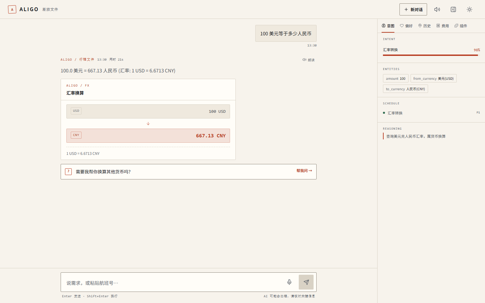

# 在线演示（Demo）

## 当前演示地址

**https://a33d4d9ae24bff.lhr.life**

> 这是**真实运行**的实例：链接通过 SSH 反向隧道指向本机 `server/app.py`，
> 所有回答都由真实 LLM 生成（不是预录数据），知识库检索、火车票、费用记录等技能都会真实工作。
> 已验证：公网 `/api/health` 200、页面可交互、汇率卡返回 `1 USD = 6.6713 CNY`。



上图即通过公网链接发起的真实请求（汇率换算返回 `1 USD = 6.6713 CNY`），页面与卡片均为公网加载。

### 时效与关闭

当前演示以**独立后台进程**运行（`Start-Process` 启动的 `python server/app.py` 与 `ssh` 隧道），
不随终端会话结束而中断；但**重启机器、断网或进程被杀**后链接会失效（表现为 502）。

查看运行中的实例：

```powershell
Get-NetTCPConnection -LocalPort 3003 -State Listen      # 服务是否在跑
Get-CimInstance Win32_Process -Filter "Name='ssh.exe'"  # 隧道是否在跑
Get-Content data/demo-runtime/tunnel.out.log            # 当前公网地址
```

演示结束后建议主动关闭，避免服务长期暴露：`Stop-Process -Id <pid>`。

## 为什么不用 GitHub Pages

本项目是 **FastAPI 后端 + React 前端** 的单体应用，前端全部数据来自 `/api/*` 且需要服务端持有模型密钥。
GitHub Pages 只能托管静态文件，无法运行 Python 后端；若把密钥放进前端构建产物，任何人打开开发者工具即可拿到。

同时本机环境还有两个客观限制（已实测）：

1. `github.com` / `api.github.com` 被 hosts 屏蔽到 `127.0.0.1`（Steam++ 残留条目，见下），网页与 API 都不通；
2. `gh` CLI 的 keyring token 已失效（`gh auth status` 报 invalid），无法脚本化开启 Pages。

因此本仓库的演示采用「本机服务 + 反向隧道」：既能真实交互，又不需要把密钥交到浏览器。

## 隧道选型（全部实测过）

| 方案 | 结果 |
|---|---|
| **localhost.run** | ✅ 采用。无警告页，浏览器直接可用 |
| cloudflared | ❌ 二进制从 GitHub Releases 下载，被本机 hosts 屏蔽，装不上 |
| serveo.net | ❌ 免费版对浏览器弹 `Serveo - Warning` 跳转页（curl 能过、浏览器不能） |
| pinggy.io | ❌ 启动即进入全屏 TUI，URL 无法稳定捕获 |
| localtunnel | ❌ 有「输入公网 IP 作密码」的拦截页，不适合给人看 |
| jsDelivr 托管仓库页 | ❌ 本机访问 `cdn.jsdelivr.net` 超时（code=000） |
| GitHub Pages | ❌ 需网页/API 启用（hosts 屏蔽 + gh token 失效），且静态页无后端 |

### localhost.run 的两个坑

1. **转发目标写 `127.0.0.1`**，不要写 `localhost` —— 后者可能解析到 IPv6 `::1`，
   而服务只监听 IPv4 `0.0.0.0`，表现为隧道建立成功但请求一律 **502**。
2. **重建隧道前要冷却约 30–40 秒** —— 立刻换新隧道会因服务端旧连接未释放而持续 502。
   本仓库实测：冷却 35 秒后重建，浏览器与 SSE 均正常。
3. 另注：Python `urllib` 直连该隧道偶发 `SSL: DECRYPTION_FAILED_OR_BAD_RECORD_MAC`，
   但 `curl` 与浏览器正常 —— 属客户端 TLS 实现差异，不代表隧道不可用。

## 如何自己启动演示

```powershell
# 1) 启动服务（前后端同端口，需已配置 .env 中的模型 key）
python server/app.py                     # http://127.0.0.1:3003

# 2) 另开终端建立公网隧道（需要 ssh 客户端，无需注册）
ssh -R 80:127.0.0.1:3003 nokey@localhost.run
# 输出里会打印 https://<随机id>.lhr.life，即为演示地址
```

细节见上文「隧道选型」中的两个坑（IPv4 目标 + 重建冷却）。

## 安全须知

- 隧道开放期间，**任何拿到链接的人都能调用 `/api/*`**，会消耗模型额度；演示完请关闭（`Ctrl+C` 或结束终端）。
- 密钥只存在于服务端 `.env`（已 gitignore），**不会**进入前端构建产物：已用 `git grep` 与构建产物扫描双向确认。
- 演示用的是 `public_demo` / `demo_*` 测试用户，不含真实个人数据。

## 本地直连（最简单）

如果只在同一台机器上看，不需要隧道，直接：

```powershell
python server/app.py
# 浏览器打开 http://127.0.0.1:3003
```

## 附：hosts 被 Steam++ 写入的条目

`C:\Windows\System32\drivers\etc\hosts` 中 `# Steam++ Start` 到 `# Steam++ End` 之间有 27 条
把 GitHub 域名指向 `127.0.0.1` 的记录。正常退出 Steam++（Watt Toolkit）时会自动清理；
若残留会导致 `git push`（HTTPS）与 GitHub 网页都无法访问。两种处理方式：

1. 启动 Steam++ 让它恢复（最简单）；
2. 以管理员身份删除该区间后 `ipconfig /flushdns`。

本仓库的推送目前改走 SSH 443（`ssh.github.com`，未被该列表屏蔽），不依赖 hosts：

```powershell
$ssh = 'ssh://git@ssh.github.com:443/'
git -c url."$ssh".insteadOf="https://github.com/" push origin main
```