# 前端优化记录（2026-11-07）

> 依据三个 skill 的规则执行：`redesign-existing-projects`（审计既有、不重写）、
> `ui-ux-pro-max`（优先级 1 无障碍 → 2 触控 → 6 排版色彩）、`design-taste-frontend`（禁 emoji、触感反馈、依赖先验证）。

## 起点判断：不推翻既有设计

审计发现既有视觉是**有主张的暖纸/墨色编辑风**（`--paper:#f7f3ec`、`--accent:#b83c22` 陶土红、
宋体标题 + 无衬线正文 + 等宽数字），不是通用 AI 紫蓝渐变；且已具备焦点陷阱、Escape 关闭、
`100dvh`、`aria-modal`、ErrorBoundary、`prefers-reduced-motion`。

因此按 skill 的「Fix, do not rewrite」只做**靶向修复**。
注：`design-taste-frontend` 默认禁衬线标题，但同时 `redesign-existing-projects` 明确
「编辑/创意类项目用衬线标题配无衬线正文」——本项目属后者，故保留宋体，不套用禁令。

## 界面一览（截图取自真实运行）

以下每一张都是**服务真实跑起来、发真实请求、等结果渲染完成后**截的，不是设计稿。
采集脚本 `web/e2e/shots-collect.mjs`（Edge + CDP，无需 Playwright），每个场景用独立用户隔离。

### 空状态与行程规划

| 空状态 | 行程规划 |
|---|---|
| 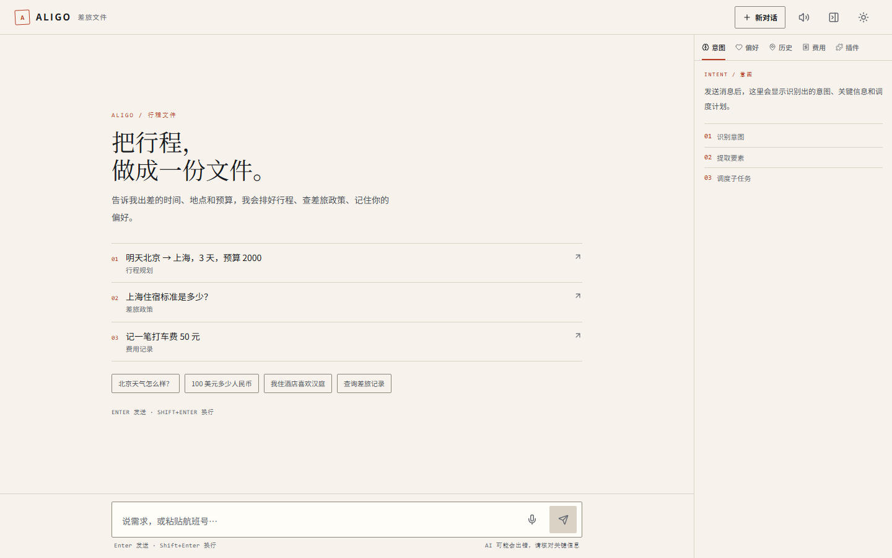 | 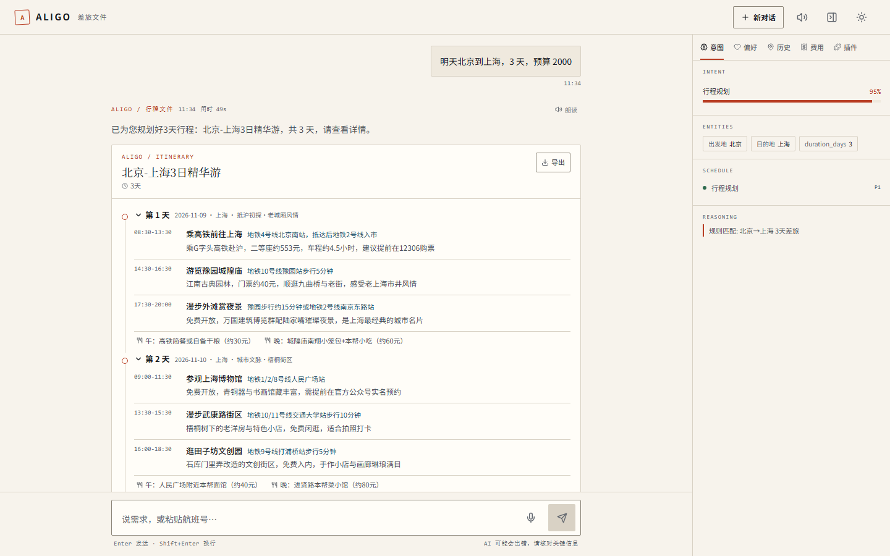 |

左侧空状态用 `01 / 02 / 03` 编号列出示例问法（等宽排版标记，非 emoji）；
右侧一句话生成 3 天行程：每天时间轴、交通方式、门票与餐饮预算逐项列出。

### 火车票与列表展开

| 车票查询（15 趟 + 余票） | 说「列出来」→ 原地展开全部 |
|---|---|
| 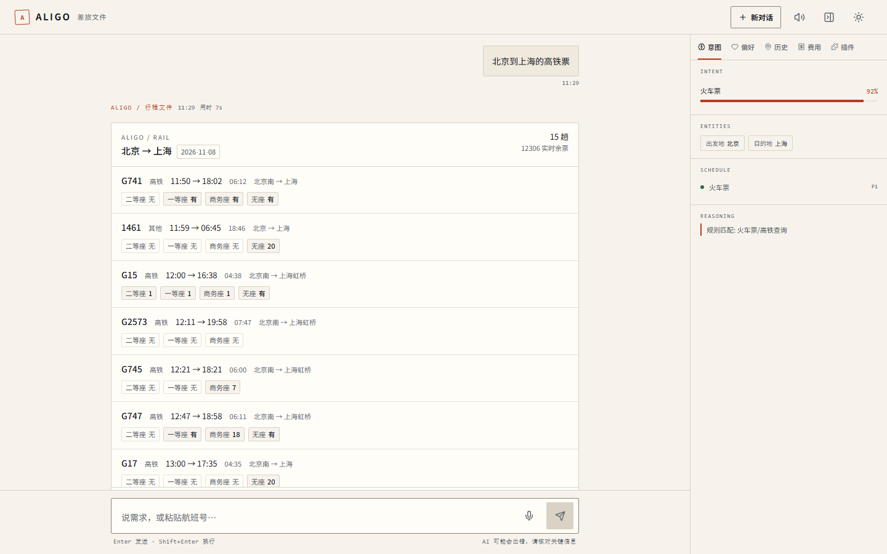 | 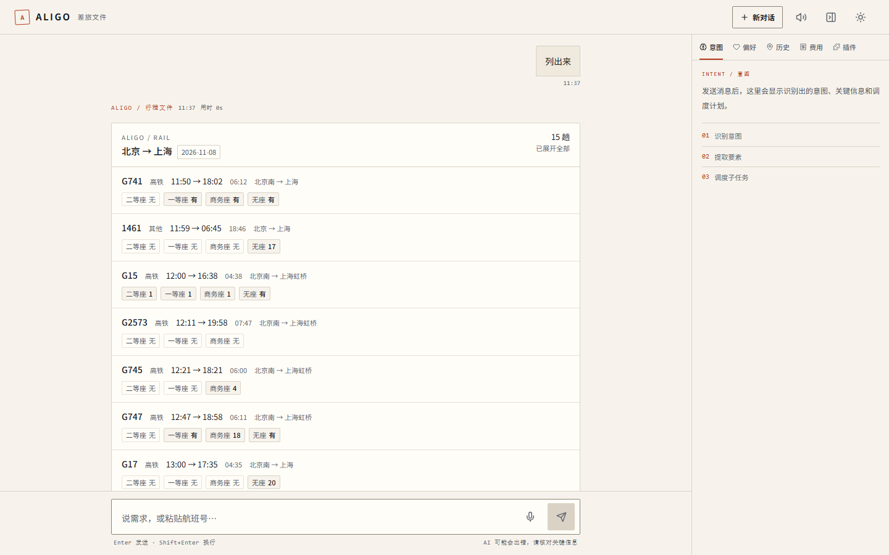 |

余票标签（`二等座 无 / 一等座 有`）是等宽小标签，标签化后面扫一眼就能比较。

### 知识库问答与天气

| 树索引检索 + 出处 | 天气卡 |
|---|---|
| 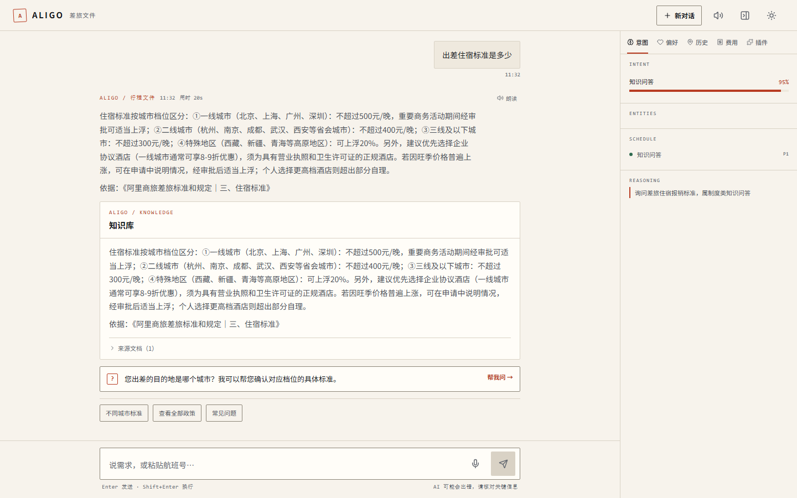 | 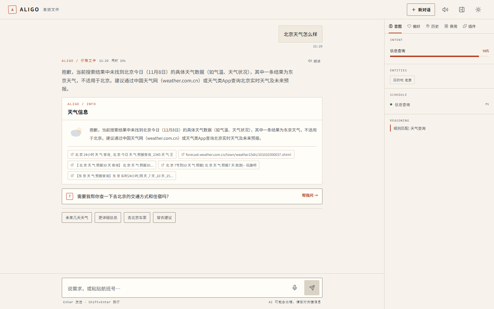 |

知识库答案带「依据：文档名 / 章节」并可展开来源，这是树索引相对向量检索的可解释性优势。

### 偏好、记账与汇率

| 偏好记忆 | 记账 | 汇率 |
|---|---|---|
| 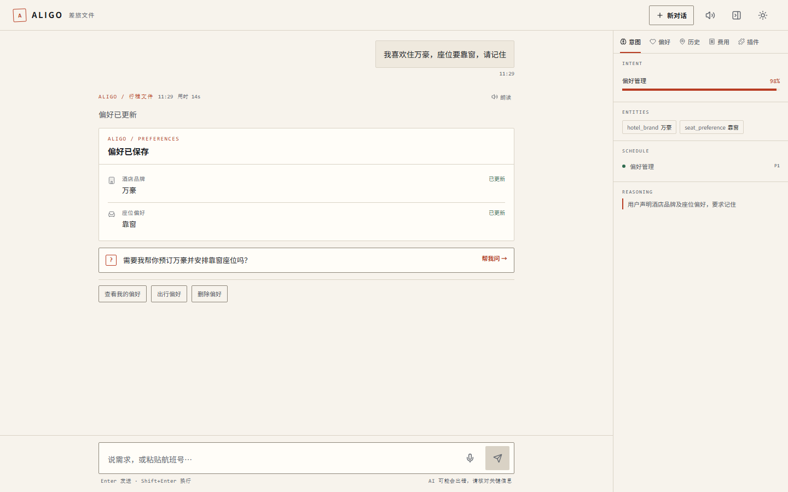 | 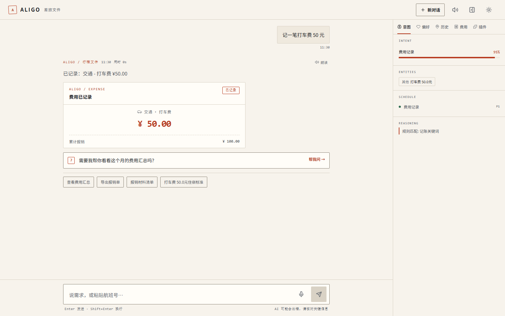 | 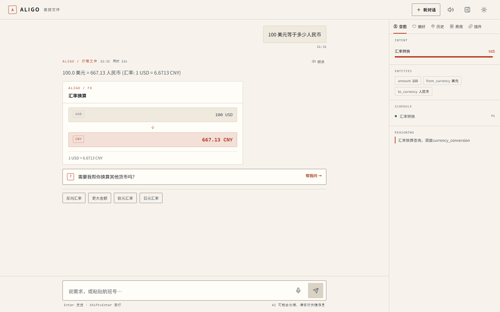 |

这三张最能体现本轮改造：

- 偏好行首图标：`🏨` → `Hotel` 线性图标、`🍽️` → `Utensils`、`❤️` → `Heart`（继承 currentColor，明暗自适应）
- 记账徽章：`✓ 已记录` → `已记录`（勾号 emoji 会让基线抖动，且不同系统字形不一致）
- 汇率：`🇺🇸 → 🇨🇳` 国旗 → `USD` / `CNY` 等宽芯片；中间箭头从文字 `↓` 换成 SVG（字符箭头跟着基线走，撑不开间距）

## 深色与移动端

| 深色主题 | 移动端 390×844（@2x） |
|---|---|
| 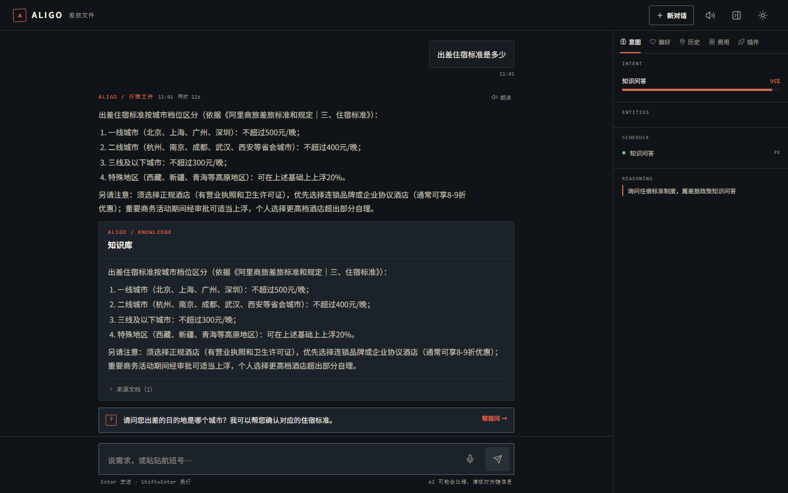 | 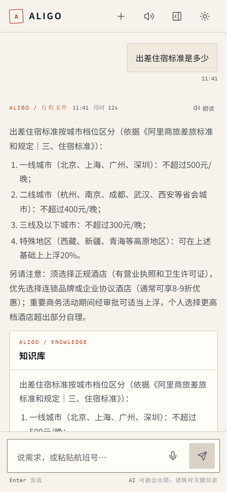 |

移动端实测：14 个可见按钮无一低于 44px（`@media (pointer: coarse)` 兜底）。
## 审计发现的硬问题与修复

| # | 问题 | 证据 | 修复 |
|---|---|---|---|
| 1 | **渲染层大量 emoji** | .tsx 中 70+ 个，另有国旗/停止符（代理对与 U+23xx，PowerShell 正则漏检，Python 复核才查全） | 全部换 lucide SVG，**渲染层归零** |
| 2 | **触感反馈全站为 0** | `active:` 命中 0 处，39 个按钮按下无回应 | globals.css 统一加按下 `scale(0.97)` + 180ms 缓动（一处覆盖全站） |
| 3 | **错误态用 emoji 编码** | `isError = content.startsWith('❌')`——emoji 承载状态语义，文案一改即静默失效 | Message 新增显式 `isError` 字段；错误块加 `role="alert"` + 警示图标 |
| 4 | **流式回复无读屏播报** | 全站 `aria-live` 仅 1 处（RouteStrip 的 sr-only） | 消息容器加 `role="log"` + `aria-live="polite"` + `aria-busy={isProcessing}`（生成中不打断，结束后整段播报） |
| 5 | **费用分类映射表重复** | ExpenseCard 与 ExpensePanel 各存一份完全相同的表 | 抽到 `categoryIcons.ts` 共享 |
| 6 | **冷暖灰混用** | AgentIcon fallback 硬编码 `#94a3b8`（冷灰）配暖纸底 | 改走 `var(--ink-3)` 等主题 token |
| 7 | **国旗 emoji 表意不准** | CurrencyCard/TranslationCard 用国旗代表币种/语言 | 改 ISO 代码芯片（币种跨国流通、语言≠国家），与票据等宽体系一致 |
| 8 | **Fast Refresh 失效** | AgentIcon/CategoryIcon 混合导出组件与常量函数 | 拆纯数据 `.ts` + 组件 `.tsx` |
| 9 | **粗指针触控目标偏小** | 移动端部分按钮 36px | `@media (pointer: coarse)` 下 `min-height:44px`，桌面保持紧凑 |
| 10 | **浅色主题一处未达 WCAG AA** | `--ink-3:#666b73` 配 `--paper-sunken` 实测 **4.44:1**（要求 4.5） | 微调为 `#62676f` → 5.15 / 5.60 / **4.71**，色相明度几乎不变 |

## 新增/改动文件

| 文件 | 作用 |
|---|---|
| `web/src/components/Icons/categoryIcons.ts` | 偏好/费用分类 → lucide 映射（纯数据，消除两处重复） |
| `web/src/components/Icons/CategoryIcon.tsx` | 两个图标组件（直接查表，满足 react-hooks/static-components） |
| `web/src/components/Icons/personaIcons.ts` | 语音人格 id → 图标；后端 `emoji` 字段保留以兼容 API，前端不再渲染 |
| `web/src/components/Icons/agentConfig.ts` | Agent 元数据与色值（改用主题 token） |
| `web/src/styles/globals.css` | 触感反馈、禁用光标、粗指针 44px |
| `tools/audit_frontend.py` | 可复跑审计：渲染层 emoji / 无障碍属性 / CSS 护栏 |
| `tools/audit_contrast.py` | WCAG 对比度实测（两主题 × 13 组配色，阈值 4.5:1） |
| `web/e2e/visual-check.mjs` | Edge+CDP 截图与计算样式探针（无需 Playwright） |

## 验证（全部实跑）

| 项 | 结果 |
|---|---|
| TypeScript | `tsc -b` exit 0 |
| 构建 | `npm run build` 成功；主包 283.46 → 280.53 kB（略降） |
| ESLint | 41 → 34 问题（37 → 30 错误），**新增文件 0 错误**；剩余均为既有 |
| 渲染层 emoji | **0**（`tools/audit_frontend.py`） |
| DOM 内 emoji | **0**（CDP 实测，含真实费用卡渲染后） |
| 触感过渡 | `transitionProperty` 含 `transform`，`transitionDuration=0.18s` |
| 读屏区域 | `role=log[aria-live]` 存在，`aria-busy` 随生成态切换 |
| 移动端触控 | 14 个可见按钮，**低于 44px 的 0 个** |
| Web 契约 | 4 passed / 2 skipped（音频需 mock，另轮已验 6/6） |
| **WCAG 对比度** | `tools/audit_contrast.py`：13 组前景/背景 × 2 主题，**全部 ≥ 4.5:1**（修复前浅色有 1 组 4.44） |

界面截图已入库到 `docs/screenshots/`，见文首「界面一览」。复跑采集：`node web/e2e/shots-collect.mjs`。

## 刻意不改的地方

- **宋体标题**：编辑风的核心识别，见上文规则冲突说明。
- **建议数据里的 76 个 emoji**：`FollowUpSuggestions.cleanSuggestion()` 已用
  `\p{Extended_Pictographic}` 在渲染出口剥离，DOM 实测为 0；这些字符串还参与去重比对，
  改动 77 条数据的收益低于回归风险。
- **ProactiveQuestion 的方框 `?`**：等宽排版标记，与 `01/02/03` 编号体系一致，非坏图标。
- **Header 桌面端 36px 按钮**：`hidden sm:flex`，移动端另有 44px 版本，属正确的响应式分工。

## 复跑方式

```powershell
python tools/audit_frontend.py                  # 静态审计（emoji / a11y / 护栏）
python tools/audit_contrast.py                  # WCAG 对比度（两主题全部需 >= 4.5）
cd web; npm run build; cd ..                    # 构建（静态挂载在启动时判定，必须先 build）
python server/app.py                            # 另开终端
node web/e2e/visual-check.mjs                   # 截图 + 计算样式探针
```